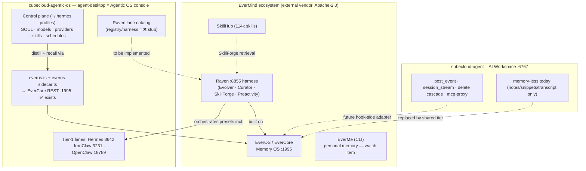

# Replan — EverMind Ecosystem Deep-Dive (EverOS · EverMe · Raven) × Cubecloud Stack

> **Date:** 2026-10-06
> **Status:** REPLAN — research + re-evaluation + roadmap revision. Still no implementation.
> **Companion to:** `docs/plans/2026-10-06-cubecloud-agent-integration-plan.md` (the workspace↔console contract; unchanged rows referenced there as "Part I").
> **Method:** fetched evermind.ai / docs.evermind.ai / raven.evermind.ai / github.com/EverMind-AI/Raven; four parallel local explorations (EverOS repo, agentic-os wiring, cubecloud-agent memory hooks, skills-bundle-kit). Every primary claim cites a file path or fetched page.

---

## 0. Executive summary — what this research changes

1. **The biggest finding:** agent-desktop's existing EverOS client (`agent-desktop/src/main/everos.ts`, default `http://127.0.0.1:1995`, `POST /api/v1/memories` + `POST /api/v1/memories/search`) speaks the **exact same REST contract as EverMind's EverCore engine** (verified in the local EverOS repo: `EverOS/methods/EverCore/src/infra_layer/adapters/input/api/memory_controller.py`, `memory_search_controller.py`). EverCore can therefore be **one shared memory tier serving both cubecloud-agent and agent-desktop** — closing the "two memory stacks" problem before it starts, instead of building dual memory.
2. **Raven has matured upstream**: now **v0.2.4 (2026-10-03)**, Apache-2.0, with a WebUI (`raven web` → `http://localhost:18793`), Docker quickstart, four SOTA built-in agents (Research / Code / Design / Oncall), an **Evolver** and an experimental **Curator** for runtime self-evolution, **SkillForge** (local + EverOS + SkillHub 114,190 skills), **Proactivity**, and 13 third-party agent presets — **including Hermes Agent, OpenClaw, Codex, Claude Code, GitHub Copilot, Qwen Code**. Our tree's catalog note ("pre-alpha v0.1.x") is stale; our probe targets the OpenAI-compatible gateway on **8855** (distinct from the WebUI port 18793 — two different surfaces, do not conflate).
3. **"EverME" clarified**: no string `EverMe` exists anywhere in our repos (zero matches). The real product is **EverMe**, EverMind's "Personal Memory Hub" — in Raven's own ecosystem table: *"EverMe (CLI): A CLI and agent plugin suite for cross-device, cross-agent personal memory."* It is a personal/roaming memory layer, distinct from EverOS's agent/group memory. Out of scope for the console today; recorded as a watch item.
4. **Local EverOS repo layout surprise**: `d:\users\joeyzh\github-pr\EverOS` is the EverMind-AI **umbrella repo** (methods/ EverCore + HyperMem, use-cases/, benchmarks/); the integrable system is **`methods/EverCore`** (project name `memsys`, Python 3.12, FastAPI :1995, MongoDB+ES+Milvus+Redis+Kafka). The desktop sidecar runs a published `everos` 1.0.1 wheel, which has a **known Windows crash** (`fcntl` import) — Windows sidecar is HTTP/remote-only per `agent-desktop/docs/EVEROS-SIDECAR.md`.
5. **cubecloud-agent is memory-less natively — confirmed**, but its lifecycle gives clean hook points (`post_event` pre/post-persist, `runtime/session_stream` pub/sub, delete cascade, lifespan sidecars, session-scoped MCP servers), and it already ships an external memory-consumer MCP bridge (`cubecloud_agent_memory/`, reading Hermes' `~/.hermes/state.db` + `MEMORY.md`) — proving the intended memory path is MCP/hook, not a native store.
6. **Skills-bundle-kit**: zero EverOS/EverMind intersection (`d:\dev\cubecloud-skillsboundle-setup`, 257 skills, SkillSpector gate). Its **SkillOpt-Sleep** (nightly transcript mining → staged skill proposals) and **`self-learning`** skill are functional analogs of EverMind's case→agent_skill distillation loop — precedent for UX, not shared code.
7. **Memory-consolidation finding for our own stack**: the desktop already carries FOUR memory-ish surfaces (EverOS sidecar, gbrain probe, Codebase Memory/CMM, flat `memory.ts`). The replan sets explicit scope boundaries instead of merging them (§4.4).

**Verdict:** the Part-I plan survives this research unchanged in its workspace↔console contract; what changes is (a) one new contract row — **shared memory tier (EverCore)**, (b) Raven lane gets real phases instead of a throwing stub, (c) the roadmap interleaves memory-harness phases with the Part-I phases, (d) several stale-doc facts to correct.

---

## 1. The EverMind ecosystem (fetched research)

### 1.1 Product map (evermind.ai + Raven ecosystem table)

| Layer | Artifact | What it is | Relevance to Cubecloud |
|---|---|---|---|
| **Memory engine** | **EverCore** (in EverOS umbrella repo, project `memsys`) | FastAPI :1995 memory OS: MemCell store, profile/episodic/foresight/atomic_fact/agent_memory types, hybrid retrieval, temporal tracking | **The shared memory tier candidate** — our `everos.ts` already speaks its API |
| **Memory OS product** | **EverOS** | Open source (Apache-2.0) + Cloud (everos.evermind.ai); mRAG multimodal ingestion; Memory Bank UI (inspect/edit generated skills); group + agent + user memory; self-evolving Cases→Skills | Names the memory tier in our platform story ("Skills, tools and memory") |
| **Agent harness** | **Raven** v0.2.4 | "Harness of harnesses" host agent ON EverOS; 4 built-in agents; Evolver (offline harness refiner); Curator (experimental per-agent strategy rewriter: Memory/Planning/Capability/Action); SkillForge; Proactivity; 13 third-party presets incl. our lanes | **Tier-1 runtime lane** in agent-desktop (port 8855); its orchestrator overlaps our tier-4 CLI catalog — coordinate, don't duplicate |
| **Personal memory** | **EverMe** | CLI + agent plugin suite for cross-device, cross-agent **personal** memory ("Memory Nebula" digital twin) | Watch item; could later be the operator's roaming memory across desktop/web/mobile |
| **Skill marketplace** | **SkillHub** | 114,190-skill catalog retrieved by SkillForge | Optional skill source next to our own catalog |
| **Research/eval** | HyperMem, MSA, EverMemBench, EvoAgentBench, EverAlgo, SkillCorpus | Papers + benches (LoCoMo 93.05%, LongMemEval 83%, HaluMem 93.04%) | Evaluation partners for our Agent Eval Framework |

Deployment split on evermind.ai: **Open Source** (run full stack on own infra — matches our sovereign/local-first promise) vs **Cloud** (managed). **Cubecloud default must be local EverCore; cloud is opt-in only** (data-stays-in-house is a product page headline).

### 1.2 EverCore integration contract (from the local repo)

- Port **1995**; routes: `GET /health`, `POST /api/v1/memories` (batch add; async extraction via boundary detection/Kafka), `POST /api/v1/memories/search` (`method`: keyword/vector/**hybrid**/agentic; `memory_types` filter; `user_id`/`group_id`/`session_id`/`timestamp` filter DSL), settings/groups/senders controllers. Legacy v0 paths exist. **Local controllers: `default_auth="none"`** — open API on loopback today; the console must treat the memory tier as local-trust and not expose it beyond loopback.
- Storage: MongoDB (MemCells `v1_memcells`, agent cases `v1_agent_cases`), ES 8 (BM25), Milvus 2.5 (Qwen3-Embedding-4B @1024D), Redis, Kafka ingest. Docker compose in `methods/EverCore/docker-compose.yaml`.
- **No bundled MCP server for local mode** (`src/infra_layer/adapters/input/mcp/__init__.py` is an empty stub; MCP exists only in the claude-code-plugin use-case against EverMem Cloud via `use-cases/claude-code-plugin/mcp/server.js`). Our integration is therefore **native REST**, which is what `everos.ts` already is.

### 1.3 Raven attach contract (fetched + our tree)

- Chat: OpenAI-compatible gateway on **8855** (our desktop probes `/health`, matches `"runtime":"raven"`/`"evermind"` — `agent-desktop/src/main/hermes.ts:352-405`).
- WebUI: **18793** (browser surface, not the gateway) via `raven web`; Docker quickstart `docker/docker-compose.yml`.
- Version/identity: v0.2.4, Apache-2.0, pre-alpha upstream warning retained.
- Orchestration: Raven can host **our** Hermes/OpenClaw lanes (its presets list "Hermes Agent", "OpenClaw") — meaning **Raven sits above runtime lanes**; the desktop must present it as a lane that *coordinates*, not another HTTP chat bolt-on.

---

## 2. What our wiring looks like today (re-evaluated)

### 2.1 agent-desktop — Raven lane state (findings)

| Element | Status | Evidence |
|---|---|---|
| Catalog entry `id:"raven"` | ✅ `integrationStatus:"optional"`, chat gateway + task exec | `src/shared/runtime-orchestration.ts` ~L222 |
| Port preset + detection | ✅ 8855, health-body match `"raven"/"evermind"` | `src/shared/runtime-defaults.ts:13`, `src/main/hermes.ts:352-405`, `src/shared/gateway-runtime-presets.ts:113` |
| **Harness adapter** | ❌ **stub throws** "Raven harness not yet implemented (P1 stub)" | `src/main/harnesses/registry.ts:80` |
| **Registry snapshot** | ❌ inconsistent: hardcodes `planned/available:false`, no scan action (vs catalog "optional") | `src/main/runtime-registry.ts:143-160` |
| Welcome lane | ✅ "Wire Raven (EverMind)" surface, default 127.0.0.1:8855 | `screens/Welcome/Welcome.tsx:157-225` |
| platform-core | ✅ `PlatformRuntimeProviderId` incl. `raven`; platform entry `planned`; smoke targets `raven-remote`/`raven-ssh` | `packages/platform-core/src/index.ts:516,1428-1457,1635,1653` |
| Catalog version claim | ⚠️ stale ("v0.1.x") vs upstream v0.2.4 | changelogs/2.10.77.md:28-41 |
| **EverOS client + sidecar + IPC + screen** | ✅ full family already wired (config form, health, add/search, sidecar lifecycle) | `src/main/everos.ts`, `src/main/everos-sidecar.ts`, `src/main/index.ts:2580-2656`, `screens/EverOS/EverOS.tsx`, `tests/everos-sidecar.test.ts` |
| **Chat↔memory wiring** | ❌ `chat-middleware.ts:19` marks memoryExtract "future" — no recall inject, no distill write | `src/main/chat-middleware.ts` |
| **`EverOsHarness` contract** | ❌ vestigial (type in platform-core, zero consumers) | `platform-core/src/index.ts:292-327` |
| Windows sidecar | ❌ wheel bug (`fcntl`) → HTTP/remote-only on Windows | `agent-desktop/docs/EVEROS-SIDECAR.md` |
| Seed claims in docs | ⚠️ stale: HANDBOOK/NOTICE cite `defaultHarnesses.ts` + 3 EverOS harnesses that **do not exist** (`agent-desktop/src/main/` has only `default-models.ts`) | `agent-desktop/docs/HANDBOOK.md:211`, `NOTICE:34`, `docs/RETIRED_AND_LEGACY.md:15` |

### 2.2 cubecloud-agent — memory posture (findings)

- **Native memory: none.** Confirmed: no EverOS/EverMind/Milvus/Qdrant/Chroma anywhere in `cubecloud_agent/`.
- Has: transcript (`conversation_store`) + substring session search, conversation-scoped **notes/snippets** (`note_store`, `snippet_store` → `/v1/sessions/{id}/resources/…`), files+tags+FTS5 index, image-CLIP embeddings only (`file_embedding_store` + `file_embed_worker.py`, RRF fusion in `routes/file_index.py`) — image search, not conversation memory.
- External bridge exists: **`cubecloud_agent_memory/`** (PyPI `cubecloud-agent-memory`, deps `mcp>=1.0`) — stdio MCP tools `recall_sessions` (FTS5 over Hermes `~/.hermes/state.db`), `recall_memories` (`~/.hermes/MEMORY.md`), `recall_profile` (`USER.md`). Consumer-only today.
- **Hook points** (where memory writes/recalls can attach): `post_event` (`routes/sessions.py`) — `_evaluate_input_policy` = pre-forward recall injection point, conversation append = persist-before-forward; assistant-output persist via `_relay_persist`/`_flush_relay_text`; distill window = `session.status → idle` edge; subscribe-side = `runtime/session_stream.publish/subscribe`; delete cascade in `delete_session`; lifespan sidecar pattern in `app.py _lifespan`.
- MCP: `POST /v1/sessions/{id}/mcp` = policy-evaluating MCP proxy delegating to runner execute; client config = agent-spec `mcp_servers` + `POST/GET/PUT/DELETE /v1/sessions/{id}/agent/mcp-servers`.

### 2.3 skills-bundle-kit — overlap verdict

- No EverOS/EverMind strings anywhere; functional analogs only: `self-learning` (session→skill capture), **SkillOpt-Sleep** (scheduled transcript mining → validation-gated staged skill proposal — the closest structural analog to EverMind's case→agent_skill loop), `rules-distill`, `knowledge-ops`; `gbrain` is a separate memory product (user-level). Path: `d:\dev\cubecloud-skillsboundle-setup` (my earlier session notes' path was correct; the `github-pr` paths do not exist).

---

## 3. The three-way relationship (defined)

**Canonical rules this diagram encodes:**

1. **EverCore is the single long-term memory tier.** Both apps attach to ONE local EverCore instance: desktop via its existing `everos.ts` client; cubecloud-agent via a hook-side adapter (§4.2 row H). Memory truth lives in EverCore, not in either app.
2. **Raven is a tier-1 lane in the desktop** — attach + harness adapter + memory-fed. It orchestrates lanes/CLIs; it does NOT replace Hermes (default) nor the workspace.
3. **EverMe stays out** until a personal-memory requirement lands (cross-device roaming is a consumer product axis, not the appliance operator axis).
4. **Skill sources stay federated**: desktop skills dir + skills-bundle-kit + (optional, later) Raven SkillForge/SkillHub + EverOS agent_skill entries — each with attribution; no vendoring.

---

## 4. Revised integration design (rows changed)

### 4.1 Part-I contract rows: unchanged
Rows A–G stand as written in the companion plan (`2026-10-06-cubecloud-agent-integration-plan.md` §5.2).

### 4.2 New/changed rows (this replan)

| # | Capability | Uses (exists today) | Notes |
|---|---|---|---|
| **H** | **Shared memory tier (EverCore)** — one local EverCore attached to both apps; desktop console card shows memory tier health alongside workspace health | Desktop: `everos.ts`/`everos-sidecar.ts` (✅). Workspace: future hook-side adapter at `post_event` pre-forward (recall inject) + idle-edge distill, or subscription daemon on `session_stream`. Search `method:"hybrid"` | Sovereignty rule: **local EverCore default; EverMem Cloud strictly opt-in.** Loopback-only trust (`default_auth="none"` on local controllers) — the desktop should keep it that way and never publish the port |
| **I** | **Raven harness adapter + registry consistency** — implement the real adapter replacing the throwing stub; make `runtime-registry.ts` reflect catalog (`optional` + available-scan) | Probe exists (`hermes.ts`); gateway contract exists; EverOS memory feeds Raven | Gate after row H (Raven performs best with its memory tier present). Keep Hermes default per catalog note |
| **J** | **Desktop chat↔memory wiring** (desktop-side, no upstream need) | `chat-middleware.ts` memoryExtract slot (already reserved); recall inject before forward; distill on session-close to `POST /api/v1/memories`; Memory Bank visibility in the EverOS screen | The missing "self-evolving desktop" piece; small and additive |
| **K** | **Skills bridge — broadened row E** | Sources: desktop `~/.hermes/skills/` + skills-bundle-kit entries (SkillSpector-gated) + kit's SkillOpt-Sleep staged proposals; destinations: `/api/agents` bundles (Part-I row E) **and** EverOS `agent_skill` records; EverOS Memory Bank UI precedent for inspect/edit | EverOS agent_skill has confidence/maturity fields — map desktop skill provenance onto them |

### 4.3 Attachment-mode matrix: updated with a memory column

Part-I §5.4 modes M0–M3 unchanged except each gains: **memory tier = local EverCore (M0/M1/M2/M3 all)**; EverMem Cloud permitted only as explicit operator opt-in in M3 (hosted appliance) — and even then recorded in the provision-time env (§5.3 single-writer rule applies).

### 4.4 Memory-surface boundary table (anti-consolidation)

| Surface | Scope it owns | Not for |
|---|---|---|
| **EverCore (tier H)** | long-term: episodic/profile/foresight/agent cases/skills; group + multi-agent | config, code knowledge |
| `gbrain` (existing probe) | user-level personal knowledge base (notes/life-events) | appliance agent memory |
| Codebase Memory (CMM) | code-graph facts (Cypher) | conversational memory |
| `memory.ts` (flat) | small per-profile key-facts file | anything scale-y |

Rule: no cross-meshing these into one blob; the console lists them as distinct memory surfaces. (This answers "more?" — the honest architecture is boundaries, not a monolith.)

---

## 5. Revised roadmap (integrating with Part-I; CEO MVP finding still governs)

**MVP unchanged: P0 + P1** (Part-I) — but P0's card now also reads the EverOS block (`everos.ts` config already exists) so memory-tier health shows day one.

| Phase | Deliverable | Verify |
|---|---|---|
| **P0** — Probe & attach card | unchanged + card reads EverOS health from existing config | vitest + live probe :6767 + :1995 |
| ↑ **STATUS (2026-10-07, UPDATED):** P0 (probe half) + **P0.5 + P1 implemented** on `feat/workspace-console-probe` — workspace probe + Tools card live (8 tests), `raven-registry-consistency.test.ts` 4/4 green (registry detected-aware optional, catalog 0.2.x/ports fixed), supervisor module 4 tests green (CLI-based `omnigent server start/stop`). **Operator decision (2026-10-07): no EverOS/EverCore integration into the workspace attach path.** A briefly-attempted P1.5 memory-tier ensure was reverted in the same branch (suite back to 128 files/1421). EverOS remains exactly what §2.1's table already describes: an existing desktop third-party tool surface (`everos.ts` client + sidecar + IPC + EverOS screen) that the console lists as one of its distinct memory surfaces. Rows H, J, and the EverCore-centric rows below are **parked pending an explicit operator request** — the coordination work now proceeds relationship/registry-level per `docs/plans/2026-10-06-workspace-agentic-os-coordination-matrix.md`. |
| **P0.5** — Raven registry/probe consistency + catalog version refresh | `runtime-registry.ts` returns catalog-true state; catalog note bumped to 0.2.x reality | vitest registry snapshot vs catalog |
| **J-phase (new)** — Desktop chat↔memory wiring | recall inject via middleware slot; distill on session end | middleware unit tests with a fake EverCore; no change to gateway contract — **PARKED (operator decision 2026-10-07: no EverOS integration)** |
| **P1** — Workspace lifecycle supervisor | unchanged (Part-I §5.6) | spawn → /health 200 → stop |
| **P1.5** — EverCore lifecycle add-on | supervisor provisions/starts local EverCore (compose or `run.py`) alongside workspace | health :1995 in the same smoke |
| ↑ **SUPERSEDED (2026-10-07):** P1.5 was implemented (3 tests green) then **reverted by operator decision** — EverOS is a third-party tool surface on the Agentic OS, not a component of the workspace attach contract. The workspace supervisor has no everos coupling; EverOS lifecycle stays owned by its own Tools panel + `everos-sidecar.ts`, exactly as before. | |
| **P2** — Workspace embed | unchanged; embed COOP/COEP spike still gated | crossOriginIsolated check |
| **P3** — Read-only session console | unchanged; **CI ban same-commit** (Part-I §7) | SSE fixture + guard test |
| **H-phase** — Workspace memory hook adapter | hook-side adapter for cubecloud-agent (upstream PR or sidecar daemon on `session_stream`) — **needs upstream coordination; park pending that decision** — **PARKED (operator decision 2026-10-07: no EverOS integration)** | recorded-SSE replay → memories appear in EverCore |
| **P4/K** — Skills bridge (broadened) | translator to `/api/agents` + `agent_skill` promotion; optional kit-skill staging import | round-trip ≥3 skills both destinations |
| **I-phase** — Raven harness adapter | replace stub; memory-fed Raven turn; keep Hermes default | golden-path smoke against local Raven 0.2.4 |
| **P5** — Config center + vault bridge | unchanged; auth-bridge spec gate stands | hash-stamped env; no secrets in source |
| **P6** — Governance relay | unchanged | approval inbox E2E |

Sequencing rationale (DAG): P0 → {P0.5, P1, J-phase} → {P1.5, P2, H-phase(gated)} → P3 → P4/K → I-phase(gated on J+EverCore) → P5 → P6. CEO kill signal unchanged.

---

## 6. Corrective findings to log (docs-debt, not blocking)

1. Stale seeds: `agent-desktop/docs/HANDBOOK.md:211`, `NOTICE:34`, `docs/HANDBOOK.md:210-215`, `docs/RETIRED_AND_LEGACY.md:15` cite `defaultHarnesses.ts` + 3 EverOS harnesses that do not exist in `agent-desktop/src/main/` (only `default-models.ts`). Fix in the P7-per-phase docs rule when the harness work lands — or as a separate docs-hygiene commit, user's call.
2. Catalog Raven version note ("pre-alpha v0.1.x") vs upstream v0.2.4 — fix when P0.5 lands; also note WebUI (18793) vs gateway (8855) as distinct surfaces in `gateway-runtime-presets.ts` comments.
3. Wheel/version mismatch: desktop sidecar runs `everos` 1.0.1 wheel (fcntl-broken on Windows) while local EverCore source (`methods/EverCore`, `memsys`) is current; P1.5 supervisor should prefer **container mode on Windows** until a fixed wheel ships.
4. `EverOsHarness` in platform-core is vestigial — either wire it in H-phase or delete it with consent (drive-by rule: propose, don't silently remove).

---

## 7. What this replan does NOT do

- No implementation, no dependency changes, no upstream PRs opened.
- No decision to adopt EverMem Cloud (explicitly deferred; sovereignty default recorded).
- No merging of memory surfaces (§4.4 boundaries are the deliverable, not consolidation).

**Immediate next actions when the user returns:** (1) confirm the three-way partition in §3 (esp. EverCore as THE shared tier + EverMe out-of-scope); (2) confirm the revised DAG and especially where H-phase sits (needs cubecloud-agent upstream appetite); (3) then green-light P0+P0.5 (both additive, small) before the J-phase memory wiring.