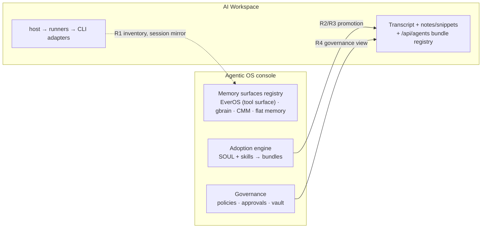

# Coordination Matrix — AI Workspace × Agentic OS (relationship & registry design)

> **Date:** 2026-10-07
> **Status:** ANALYSIS + DESIGN — relationship evaluation and coordination design. The MVP code (P0 + P0.5 + P1) already implemented on `feat/workspace-console-probe` provides the transport (probe, card, supervisor); everything below defines **what the console coordinates**, not a new runtime.
> **Companion docs:**
> - `2026-10-06-cubecloud-agent-integration-plan.md` — the attach contract rows A–G (unchanged; this doc extends them)
> - `2026-10-06-evermind-memory-harness-replan.md` — EverMind research; **operator decision 2026-10-07: NO EverOS/EverCore integration** — EverOS stays a third-party tool surface
> **Operator directives honored (2026-10-07):**
> 1. English-only output.
> 2. EverOS is **not** being integrated — it already lives on the Agentic OS as a third-party tool surface and stays there.
> 3. The goal is **relationship analysis → better coordination**: the Agentic OS is a **control board / operating console** that adopts and manages the AI Workspace's **persona, core memories, skills, tools, channels, and harnesses** — both cores standalone **or** in parallel — powered by the skills bundle kit, with every core free to update/add/edit tools, CLIs, and third-party apps and to **evolve with its own persistent long memory**.

---

## 0. Executive summary

The two cores are **peers with a boss**, not a monolith:

- **AI Workspace (cubecloud-agent, :6767)** = the *conversational operating fabric*: it owns turns, sessions, files, voice I/O, and the runner/host fabric that actually executes work with 13+ native CLI adapters.
- **Agentic OS (agent-desktop)** = the *control board and operating console*: it owns the operator's standing configuration — persona (SOUL), models/providers, skills, memory surfaces, tools/MCP, channels, schedules, policies, approvals — and it **coordinates** the Workspace rather than replacing it.

The coordination problem is therefore **not** "merge the memory" or "share one brain." It is: *which surface owns which resource, how does the console adopt/review/promote the Workspace's resources, and how do the two stay consistent without either rewriting the other's files.*

The answer is a **registry-level coordination model** with four mechanisms:

| Mechanism | One-liner | New code? |
|---|---|---|
| **M-A Inventory bridge** | Console reads the Workspace's `/v1/agents`, `/v1/info`, `/v1/policy-registry`, `/v1/scheduled_tasks` and renders them alongside its own registries | thin read-only client + card rows (P3/P5 family) |
| **M-B Adoption lanes** | Console promotes desktop-authoritative resources INTO the Workspace (skills→`POST /api/agents` bundles, persona→agent YAML, models→env at provision time) | row E translator (P4) |
| **M-C Delegation lanes** | Workspace delegates back: harness/CLI catalog entries, approvals surface, read-only session mirror (rows D, G) | P3/P6 |
| **M-D Divergence guards** | Single-writer rule per config domain + CI bans (session-mutation ban ships with P3) | §5.3 of Part-I, unchanged |

**Evolving-with-memory** is preserved per core: the desktop's persistent long memory lives in its own surfaces (EverOS tool surface, gbrain, CMM, flat memory — *each already separate; no cross-wiring per the operator decision*), and the Workspace evolves its own (transcript + notes/snippets + `/api/agents` bundle registry). The console **inspects both**, drives governance on both, but **never fuses them**.

---

## 1. Relationship evaluation — the six resource domains

Both cores manage the **same six domains** of an agent platform. Mapping who-owns-what is the entire coordination design.

| Domain | Agentic OS (console) owns | AI Workspace owns | Coordination mechanism |
|---|---|---|---|
| **Persona** | `SOUL` screen — persona definition, profile-scoped (`~/.hermes`), authoritative for runtime lanes | Per-agent YAML bundles (`POST /api/agents`; name becomes the "model") + per-session agent assignment | **Adoption lane B1** — console authors persona; Workspace consumes compiled agent YAML. Workspace never edits the SOUL source; console never owns Workspace's per-session agent choice |
| **Core memories** | Memory surfaces list (EverOS tool surface, gbrain, CMM, flat `memory.ts`) — **displayed as distinct registries, never fused** (operator decision) | Transcript + notes/snippets + its own bundle registry | **Divergence guard** — memory reads via their own surfaces only; the console renders Workspace memory-ish resources (notes/snippets/file-index) alongside desktop surfaces but writes nothing |
| **Skills** | `~/.hermes/skills/` + skills bundle kit (SkillSpector-gated) + staged SkillOpt proposals | YAML agent bundles (each bundle ≈ a skill-pack) + tmux harness aliases | **Adoption lane B2** — desktop skill → `/api/agents` bundle promotion, round-trippable |
| **Tools / MCP** | Tools screen + MCP screen (registry, one-click install, approval gating) | `POST /v1/sessions/{id}/mcp` proxy + per-session `mcp_servers` agent-spec | **Delegation lane C1** — Workspace sessions declare their own MCP servers; console governs via policy rather than dictating lists |
| **Channels** | Desktop-native: dingtalk / feishu / wecom channel connectors live in `src/main/channels/` | Workspace is the HTTP/WS entry itself (sessions, SSE, `/v1/dictation/stream`, voice proxy) | **Partition** — inbound channels stay console-side; conversational transport stays Workspace-side. No bridging phase in scope |
| **Harnesses** | `src/main/harnesses/registry.ts` (Hermes harness real; Raven stub until its phase) + 35-entry `AGENT_CLI_CATALOG` PATH-discovered | Host daemon → runners → **13 native CLI adapters (claude/codex/cursor/opencode/hermes/kimi/kiro/goose/pi/qwen/antigravity…)** in tmux panes | **Delegation lane C2** — Workspace's adapter fabric is the execution edge; console's catalog is the operator's *view*. Row-I Raven harness work stays desktop-internal and does not touch Workspace adapters |

Key asymmetry discovered in this pass: **the desktop's tier-4 CLI catalog and the Workspace's adapter fabric enumerate the same underlying CLIs from two different vantage points** (desktop: "is it on PATH?"; Workspace: "can a runner drive it in tmux?"). The inventory bridge (M-A) should reconcile these into one operator view rather than building a third catalog.

---

## 2. Standalone vs parallel — the two operating postures

The Part-I §5.4 mode matrix (M0–M3) already covers attachment; the operator's framing adds the **posture axis** orthogonal to transport:

| Posture | Meaning | What the console shows | What still works |
|---|---|---|---|
| **Standalone (either core)** | Workspace runs alone (browser SPA), or desktop runs with the Workspace absent | Console card shows `not reachable`, lifecycle buttons + install hint; all desktop surfaces fully functional | Desktop is a complete control board without the Workspace; Workspace is a complete conversational fabric without the desktop |
| **Parallel (both running)** | Workspace attached (M1) or embedded (M2) | One control board: runtime lanes + workspace card + inventory bridge rows | Lifecycle (row B), read-only session mirror (row D), adoption lanes (row E), governance relay (row G) all active |

Design rule: **parallel is additive, never required.** Every console feature must degrade to standalone — this is the same "never throws / reason field" convention the P1 supervisor already follows, applied at the coordination level.

---

## 3. The coordination surface (new contract rows, additive to Part-I §5.2)

Rows A–G stand unchanged. This doc adds rows **R1–R4** (relationship/registry level — the operator's "control board" duties):

| # | Capability (console side) | Uses (Workspace endpoints, exist today) | Verify |
|---|---|---|---|
| **R1** | **Inventory reconciliation** — one view joining (a) desktop runtime lanes + CLI catalog + third-party discovery, (b) Workspace `/v1/info` + `/v1/agents` + `/v1/stack/status` | `GET /v1/info`, `GET /v1/stack/status`, `GET /v1/agents` (bundle list) | vitest against recorded fixtures; divergence highlighted (CLI in one catalog only) |
| **R2** | **Persona/agent adoption** — compile a desktop persona (`SOUL` profile + selected skills) into a Workspace agent bundle | `POST /api/agents` (tarball, YAML spec) | round-trip: ≥3 personas compile, upload 200, listed back in `/v1/agents` |
| **R3** | **Skills promotion pipeline** — desktop skill dir → SkillSpector gate → bundle → `(personas × skills)` mapping review → promote | `POST /api/agents` + `GET /v1/agents` | round-trip ≥3 skills both directions (also mirrors Part-I row E) |
| **R4** | **Governance view of Workspace resources** — scheduled tasks, policy registry, sharing visible in the console's governance screens; approvals relay (row G) unchanged | `GET /v1/scheduled_tasks`, `GET /v1/policy-registry`, `/v1/sharing` | fixture-driven vitest; E2E rides P6 |
| **R5** | **OpenViking — optional tool surface** (agent context DB: `viking://` FS, MCP at `/mcp`, L0/L1/L2 tiered reading; AGPL-3.0 core → interop-only, never vendored) | local server `127.0.0.1:1933`, MCP `openviking_*` tools, REST `/api/v1/*` | probe + card + MCP registration (mirrors gbrain family); listed as a DISTINCT memory/context surface (boundary table §4.4) |
| **R6** | **WeKnora — optional tool surface + kit retrieval** (enterprise RAG; MIT; built-in MCP `/mcp/<endpoint_id>`, REST `/api/v1`) | `weknora_search` / `read_document` / `list_knowledge_bases` MCP tools; REST knowledge APIs | probe + card + MCP registration; skills bundle kit skills may call it for grounded retrieval; retrieval-only (no `agent-chat` lane on the console side) |
| **R7** | **Laya — decision-model layer in the console core** (System-1: typed choice/score/noul, ~33 ms, abstention via `min_confidence`) | MCP stdio `laya-mcp-server` (`laya_decide`, `laya_preset`, `laya_route`, …) or local `laya-serve` HTTP `/v1/systemone` | DM0 spike (MCP registration + status card) → DM1 (guard + routing middleware, fail-open) → DM2 (approval pre-screen + skill-staging triage, toggle-gated, audited) — detail in `2026-10-07-decision-core-governance-bench-replan.md` §D3 |
| **D1/D2** | **Voice de-duplication** (workspace owns voice; desktop keeps only local Handy dictation) and the **governance bench** (bench.json snapshot + bench section + nightly governance sweep over all memory/graph/gateway/tool surfaces) | D1: hide/sunset `voice-transcribe`/`voice-synthesize` + UI buttons, promote contract row F to default-on; D2: `<hermes-home>/bench.json` | detail in `2026-10-07-decision-core-governance-bench-replan.md` §D1–D2; Jev-Mem holds a watchlist slot (DM3), never a workspace dependency |

### 3.1 P5 auth-bridge spec (the written gate — decided BEFORE P5 coding, per Part-I §7 finding 3)

*Status: DECIDED 2026-10-07. This section is the gate artifact P5's coding must conform to.*

1. **Shapes in scope for M0/M1/M2:** `header` (console vault → workspace API key passed as a header credential at the workspace's own auth layer) and `accounts` (single-user local mode — no credential bridging needed because the operator **is** the account). **OIDC bridging stays out of scope** until a hosted-appliance pilot requires it (M3), where the desktop acts as a standard OIDC client application, not an identity provider.
2. **Credential flow (one direction):** desktop **vault** holds the workspace API key (operator enters it once); the console **generates** a provision-time env file (`.env` fragment) with a **hash-stamped header** (`# cubecloud-agent provision v1 <sha256-of-body-prefixed>`), writes it only to the workspace's provision directory, and **never modifies** the workspace's `config.yaml`, stores, or migrations.
3. **Single-writer rule (Part-I §5.3) enforced in code:** the console's config-center module may only write a single path (the provision env fragment) and only via an explicit operator-triggered IPC; a **CI guard test bans** the module from writing/touching `config.yaml` or containing workspace-mutation HTTP verbs — same discipline as P3's no-mutation ban.
4. **Restart contract:** any env change requires a supervised restart via the P1 supervisor (`omnigent server stop/start`); the console never signals a live server to reload env (avoiding the `/opt/data/.env` override=True bug class from the bring-up history).
5. **Secret handling:** the API key lives in the desktop vault (OS-level secret store); the provision file on disk is the only artifact containing it, marked `.gitignore`-adjacent by the workspace's own provisioning, and the console **logs only the key's fingerprint** (first 4 + last 4 chars), never the key itself (§6.6 security floor).

Sequencing: R1 rides P0's probe (transport exists) + P3's session mirror; R2/R3 = Part-I P4 with personas added; R4 = P5/P6 view duties. **No phase in this doc starts a Workspace-side code change.**

**STATUS (2026-10-07):** P3(+R1) **implemented** — `cubecloud-agent-sessions.ts` (10 tests incl. the same-commit no-mutation CI ban) + IPC/preload; **R2+R3 implemented** — `agent-bundle-compiler.ts` (9 tests: tar.gz round-trip, AGENTS.md conditional, YAML quoting, 201/409/400 promotion mapping, empty-name rejection; zero new deps; one real ustar offset bug fixed in review) + operator-gated `agent-bundle-promote` IPC; **R5 implemented** — `openviking-probe.ts` (6 tests: loopback :1933 default, remote https allowed, auth hint, bounded hang) + `openviking-probe` IPC + Tools card (interop-only, AGPL care documented); **R6/DM0 previously landed** (weknora-probe 6 tests, laya-probe 4 tests). Full suite **135 files / 1459+ tests**, both typechecks clean. R4's registry-view duties still ride P5/P6.

---

## 4. Memory doctrine (locked by the operator decision)

Rules this diagram locks:

1. **No shared memory tier.** The console's memory surfaces (including EverOS as a *third-party tool surface*) are **not** wired into the Workspace attach path. A P1.5-style ensure was built and reverted; the boundary is now doctrine.
2. **Each core evolves with its own persistent long memory.** The desktop's evolution loop is desktop-owned (EverOS tool surface if the operator enables it, gbrain, CMM, plus skills-bundle-kit's SkillOpt-Sleep staged proposals); the Workspace's evolution loop is Workspace-owned (bundle registry edits, transcript-derived resources).
3. **The console may READ Workspace memory-ish resources** (notes/snippets/file-index) for operator display — that is R1/R4 inventory, not fusion.
4. **Promotion is one-directional and explicit**: persona/skills flow console → Workspace via bundles; nothing flows back automatically. Workspace-authored bundles appear in R1's divergence view and the operator chooses to adopt them into the desktop if wanted.

---

## 5. What this doc changes in the phase plan

- **Part-I rows A–G**: unchanged.
- **P1.5 (EverCore lifecycle)**: **removed** from the roadmap (implemented-then-reverted; see replan doc's SUPERSEDED row). The EverOS lifecycle remains owned by the existing EverOS tool surface (`everos-sidecar.ts` + Tools/EverOS panels).
- **P4** becomes **R2 + R3** (persona + skills adoption) — same transport, two deliverables.
- **P5/P6** gain R1/R4's registry-view duties within their existing scope.
- **I-phase (Raven harness)**: unchanged — desktop-internal, independent of the Workspace.
- Additive phases **R1** (inventory reconciliation view) is folded into P3's deliverable; **no new phase count**.

---

## 6. Explicitly out of scope (standing)

- No shared/EverCore memory tier between the cores (operator decision, 2026-10-07).
- No bridging of desktop channels (dingtalk/feishu/wecom) into Workspace transport — partition, not bridge.
- No merged chat lane: the Workspace is never a tier-1 runtime lane; desktop never proxies Workspace chat.
- No automatic two-way skill sync — promotion is operator-triggered.
- No rewrite of the other core's config while running (single-writer rule, Part-I §5.3).

---

## 7. Immediate next actions

1. **Review this matrix** — especially §1's six-domain ownership and §4's memory doctrine.
2. The MVP (P0 + P0.5 + P1) is ready on `feat/workspace-console-probe` for merge as V2.10.80 (user approval still pending).
3. Next build step per the DAG: **P2 (workspace embed)** or **P3 (read-only session inventory — carries R1)**, both additive.
4. Real smoke when convenient: Tools → AI Workspace → Start against a real quickstart stack; then verify the R1 surfaces light up.