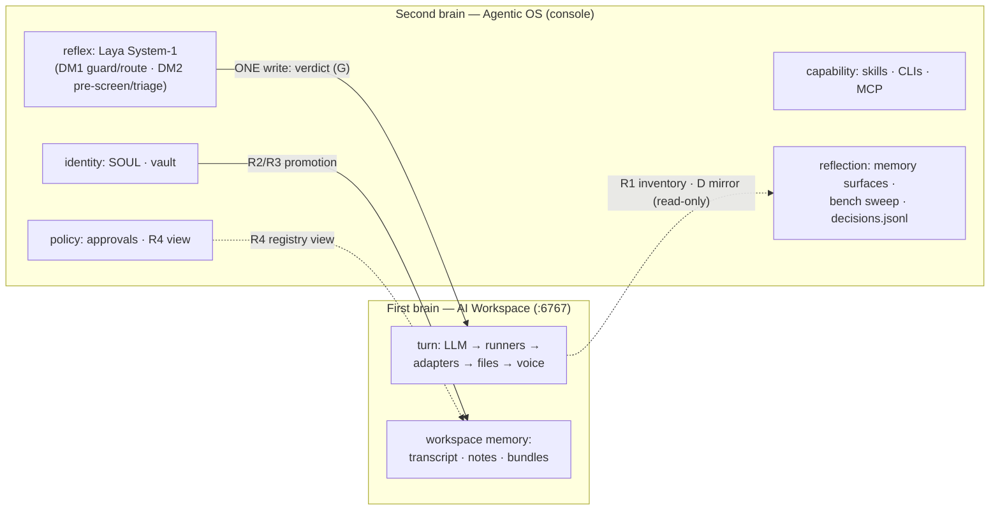

# Second-Brain Doctrine — Agentic OS as the institutional layer of the AI Workspace

> **Date:** 2026-10-07
> **Status:** DOCTRINE DOC — synthesizes the shipped V2.10.80 architecture (contract rows A–G, matrix rows R1–R7, decision core DM0–DM2) into a single named model and frames the console-kernel extraction (compose conversion C0–C3) as its infrastructural consequence.
> **Companion docs:**
> - `2026-10-06-cubecloud-agent-integration-plan.md` — attach contract rows A–G (shipped)
> - `2026-10-06-workspace-agentic-os-coordination-matrix.md` — relationship/registry design R1–R7 + memory doctrine (shipped, doctrine-locked)
> - `2026-10-07-decision-core-governance-bench-replan.md` — D1 voice de-dup, D2 governance bench, D3 Laya decision core (shipped on main; D1 design-locked)

---

## 1. The model in one line

**The Agentic OS is the operator's second brain; the AI Workspace is the first.**

- **First brain (cubecloud-agent, `:6767`)** — thinks and acts *per turn*: LLM → host/runners → CLI adapters → files → voice. It is conversation-scoped, per-session, and disposable. Sessions are its truth (contract row D: console is viewer, not owner).
- **Second brain (agent-desktop / Agentic OS)** — holds what *persists between* turns: identity (SOUL), credentials (vault), capability (skills + 35-entry CLI catalog + MCP registry), policy (approvals, policy view R4), reflexes (Laya System-1 core), and reflection (memory surfaces + decisions.jsonl audit + governance bench sweep). It is institution-scoped and long-lived.

The two are joined by **one contract with one write** — the elicitation verdict (row G, `POST /v1/sessions/{sid}/elicitations/{eid}/resolve`, 202) — plus operator-gated promotions (R2/R3 bundles, P5 provision-env). Everything else flows console→workspace as *reads*, workspace→console as *mirrors*.

## 2. Why this is a second brain (and the doctrine that makes it work)

Applying the external-brain principle ("index other brains; copy nothing"), three doctrines already shipped in V2.10.80 are exactly second-brain laws:

| Doctrine | Shipped as | Second-brain law it implements |
|---|---|---|
| **Memory: distinct surfaces, never fused** | coordination matrix §4 (P1.5 EverCore ensure built-then-reverted; boundary registry) | *Index, don't duplicate.* gbrain/EverOS/CMM/flat memory stay separate registries; the console renders + governs them, never fuses them |
| **Content-storing surfaces store pointers, not copies** | D2 bench: `bench.json` captures *pointers + health, never content*; R4 joins surfaces tolerantly | *The OS observes health and inventory; content stays owned by each surface* |
| **One write channel, everything audited** | Row G (single POST resolve), P5 (single-writer provision-env, fingerprints-only), DM2 (`decisions.jsonl`, no prompts/secrets) | *A reflex must be cheap, typed, and logged — or it doesn't belong in System-1* |

The **Laya core (DM0–DM2) is the second brain's reflex arc, not a feature**: ~33 ms typed verdicts (choice/score/noul) with confident abstention, fail-open everywhere, toggled OFF by default, and every governance verdict appended as a typed JSONL audit record. The human inbox only sees what System-1 could not safely pre-screen.

## 3. Consequence: the kernel / shell split (why compose conversion is on-doctrine)

The second brain's *substance* has already been de-Electronized by V2.10.80's own history: 83 of 92 `src/main` modules are Electron-free; only 9 import `electron`, and five of those (installer, updater, sudo/dialog, media, askpass) exist solely for desktop packaging features the operator has dropped for the compose path. The architecture therefore splits into:

- **Kernel (the second brain proper)** — the 292 `ipcMain.handle` channels as HTTP routes + the 83 portable modules + the typed audit + the bench. Runs as a container/daemon (`console-backend` service).
- **Shells (thin views over the kernel)** — (a) the Electron shell (today's desktop, unchanged), (b) the browser shell (the served renderer + a `window.hermesAPI`→fetch shim; 353 call sites across 27 screens unchanged), (c) any future appliance head (M3).

Conversion phases (C0–C3) ride this doc:
- **C0** — `console-backend/` Node service with the generated route registry (kernel boots headless; parity script asserts route-per-preload-method).
- **C1** — renderer shim (fetch/SSE) so the 27-screen renderer runs unmodified in a browser.
- **C2** — `compose.console.yaml` joins the workspace fabric (`console-backend → hermes-gateway:8642/workspace:6767` via service DNS).
- **C3** — retire Electron-only modules from the served path (never before C2's live smoke).

## 4. What this doctrine locks (standing rules)

1. **The console's chat lane and the workspace's chat surface remain different populations** — anti-duplication doctrine §D3.5 stands (voice workspace-owned; no proxied chat; memory surfaces distinct).
2. **Kernel deployments keep every reflex fail-open and every verdict human-owned** — pre-screen may mark `autoApprovable`, but the only approval delivery path remains P6's `resolveElicitation` (the human is still the hand that signs).
3. **The bench never becomes a new store** — bench.json is inventory + health + policy only; adding a new memory backend to "unify" is a doctrine violation.
4. **Promotion stays operator-triggered** — R2/R3 bundle promotion, P5 provision-env writes, and any future workspace-side export are explicit human actions, never background sync.
5. **Shells are interchangeable; the contract is not** — a shell change (Electron ↔ browser ↔ appliance) must never alter rows A–G semantics; the console-backend route registry is the *same* contract, not a new one.

## 5. Verify steps for this doc

- Doctrine consistency: this doc's five locks must not contradict matrix §4 (memory doctrine) or replan §D3.5 (anti-duplication). Checked on write; re-check on each doc edit.
- C0's parity script (`scripts/console-kernel-parity.cjs` in the C0 worktree) is the mechanical check that kernel = preload bridge surface (route-per-method).