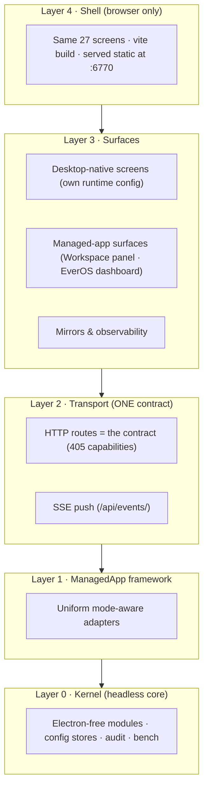

# Desktop Overhaul Design — Electron-free control plane over managed apps

> **Date:** 2026-10-08
> **Status:** APPROVED DESIGN (operator sign-off 2026-10-08) — implementation not started. This doc supersedes the workspace-attach framing of `2026-10-06-cubecloud-agent-integration-plan.md` (rows A–G remain valid as the workspace contract; the relationship model and shell strategy are replaced here) and replaces `2026-10-07-second-brain-doctrine.md` (see the corrected doctrine doc of the same date).
> **Companion docs:**
> - `2026-10-08-second-brain-doctrine.md` (rewrite) — the corrected relationship model
> - `2026-10-06-workspace-agentic-os-coordination-matrix.md` — R1–R7 rows still govern what the console coordinates
> - `2026-10-07-scan-first-onboarding-redesign.md` — superseded §3 (workspace-centric first-run) by Phase E below
>
> **Research basis:** 60+ references across six domains (control-plane case studies: Docker Desktop, Portainer, Lens, VS Code Remote, Open WebUI, Raven; memory tiering: Mem0, Zep, LangMem; MCP governance: Claude Desktop, VS Code, Cursor; scheduling: n8n, Dify, Temporal; live EverOS docs crawl 2026-10-08; full API inventory of cubecloud-agent's 31 route modules; Electron-dependency audit of this repo). Key figures cited inline.

---

## 0. Operator decisions locked (2026-10-08)

1. **Agentic OS desktop is an independent, self-sufficient control plane.** It owns and fully configures all of its surface cards. The AI Workspace is a **separate app** that the desktop discovers, attaches to, and remotely manages — never a card the desktop embeds into its identity, never the source of the desktop's onboarding.
2. **Electron is retired completely.** Both cubecloud-agent and agentic-os live in containerized environments connected by ports. The browser is the only shell.
3. **The webview embed is removed.** "Open workspace UI" is an external-browser affordance at most.
4. **EverOS becomes a managed app with a desktop-provided dashboard** (the UI its OSS build lacks), speaking the current v2 API.
5. **Docker/compose work resumes only at Phase F**, after the kernel and surfaces are complete.

---

## 1. The five-layer model



| Layer | Today | Overhauled |
|---|---|---|
| **L0 Kernel** | 83 Electron-free modules; 9 modules mix Electron with business logic | 100% Electron-free; the 9 desktop-only modules (installer wizard, updater, dialogs, askpass, sudo, media, workspace-console, runtime-provider-actions' shell use, updater-log) retire or move behind adapters |
| **L1 ManagedApp** | 12+ ad-hoc probe/sidecar modules, each with its own shape | One uniform adapter contract (§2); existing probe logic wrapped, not rewritten |
| **L2 Transport** | 405 IPC methods + a hand-written 17-route HTTP kernel + parity check | **One route registry generates the HTTP contract.** No parity drift is possible because there is nothing to parity-check against — the HTTP registry *is* the contract |
| **L3 Surfaces** | 27 screens; workspace as a Tools card + webview nav item | Desktop-native screens unchanged; new managed-app surfaces; webview embed removed |
| **L4 Shell** | Electron window + half-working browser shell | Browser only, served by the kernel container |

**Key property:** business logic exists exactly once (L0/L1). Shells and screens cannot diverge because there is nothing to diverge from.

### 1.1 Electron-drop evidence (audited 2026-10-08)

| Fact | Number |
|---|---|
| Main-process files importing `electron` | 12 of 92 |
| `index.ts` composition | 3,510 lines, 294 `ipcMain.handle`, only 10 `webContents.send` |
| Renderer `window.electron` usage | 8 files, all trivial (platform checks, versions, analytics) |
| Tests touching Electron | 3 of 122 |
| `safeStorage` / `Tray` / `Menu` / `Notification` usages | 0 |

The 12 Electron files map almost exactly onto already-retired features (installer wizard, updater, webview console, desktop dialogs). The browser shim (`console-backend/shell.ts`) already implements the transport replacement: generated `window.hermesAPI` over HTTP POST, `window.electron.on()` over SSE, never-throw degraded shapes for unseeded methods.

---

## 2. The ManagedApp contract

Every external app the desktop touches implements one interface:

```ts
interface ManagedApp {
  id: string;                    // "ai-workspace" | "everos" | "hermes" | ...
  discover(): Discovery;         // scan/probe → found | not-found | auth-required
  health(): Health;              // capability-honest status, never throws
  inventory(): Inventory;        // read-only mirrors (sessions, catalogs, stacks)
  lifecycle(): Lifecycle | null; // start/stop/restart, null if unsupported
  config(): ConfigSchema | null; // what the desktop may configure, and how
  governance(): GovHooks | null; // approvals, policies, audit hooks
}
```

### 2.1 Contract rules (locked)

1. **Capability-honest.** An adapter declares what it supports; the UI renders only declared capabilities. The degraded-shim bug class (`models is not iterable`, the getLocale crash) dies at the architecture level.
2. **Config isolation.** Each adapter owns its own config block (`desktop.json` → `workspace: {...}`, `everos: {...}`). The B1 bug class (workspace attach writing the gateway connection config) becomes unrepresentable; a CI test bans cross-block writes.
3. **One write channel per app, operator-gated.** Workspace: bundle promotion + provision-env + approval verdicts. EverOS: none (dashboard reads/edits through EverOS's own API). Everything else read-only.
4. **Mode-aware lifecycle.** Every lifecycle adapter carries `mode: "local-spawn" | "fabric-attach"`. In fabric mode, start/stop map to the compose service (or read-only status); the console container never spawns processes for fabric services.

### 2.2 Adapter roster

| Adapter | Wraps (existing modules) | Mode | Writes |
|---|---|---|---|
| `ai-workspace` | cubecloud-agent-probe / -supervisor / -sessions / agent-bundle-compiler / -config / -governance | fabric-attach (container) or local-spawn (host dev) | bundles, provision-env, verdicts |
| `everos` | everos.ts (v1 → **v2 rewrite**) | fabric-attach or local-spawn | none (dashboard uses EverOS's own API) |
| `hermes` / `ironclaw` / `openclaw` / `raven` | hermes.ts, runtime-registry.ts, gateway-runtime-presets.ts | mode-aware | gateway lifecycle (local mode only) |
| `openviking`, `weknora`, `gbrain`, `headroom`, `codegraph`, `moo-tasks`, `agent-reach`, `graphify`, `laya`, `browser-harness` | their existing probe/sidecar modules | mode-aware | sidecar lifecycle (local mode only) |

---

## 3. The workspace link (M1–M4, unchanged from validation)

| Mechanism | How | Domains |
|---|---|---|
| **M1 Live API** | Desktop calls workspace REST directly (operator-gated writes) | Scheduled tasks CRUD, server-wide policies, sharing, media settings, session MCP servers, agent bundles, elicitation approvals |
| **M2 Provision + restart** | Provision env fragment → supervised restart | Workspace LLM keys/models (startup-only config) |
| **M3 Read-only mirror** | Desktop renders workspace state alongside its own | Sessions, agents, harness/skill/MCP catalogs, policy registry, stack status |
| **M4 Lifecycle** | Supervisor + service restart | Workspace process, Hermes/Ollama/whisper services |

The workspace gets a **dedicated management surface** (panels per mechanism), not a Tools status card and not an embed.

---

## 4. EverOS: v2 + dashboard

Verified against live docs (2026-10-08 crawl): EverOS OSS is now **Markdown-first** (md = source of truth, embedded SQLite + LanceDB, zero external services), API **v2** (`/api/v2/memory/*`: add/flush/get/search), default port **:8000**, Bearer auth, `app_id`/`project_id` scope partitioning, six memory kinds + Knowledge Wiki (L0/L1/L2) + Reflection (weekly consolidation, soft-archive). **v1 retires soon**; the desktop's existing `everos.ts` speaks v1 and must be rewritten. **OSS ships no dashboard and no memory-visibility UI** — the desktop provides it.

Design:
- `everos` adapter speaks v2 only; scope `app_id: "agentic-os"` (workspace, if ever attached, uses its own scope — co-location without fusion, the Mem0/Zep tiering pattern).
- Dashboard surface: memory browse/search (hybrid method), skills (`agent_skill` dirs), wiki L0/L1/L2, reflection trigger (`POST /api/v2/ome/trigger`), cascade status (`everos cascade status` analog via API).

---

## 5. Phase DAG (final sequence)

| Phase | Scope | Verify |
|---|---|---|
| **A. Kernel completion** | All 405 capabilities as HTTP routes (mechanical registration; SSE for the 10 push channels) | route count = preload method count; full vitest; typecheck |
| **B. ManagedApp framework** | Contract + 12 adapters, mode-aware lifecycle, config-block isolation + CI ban | adapter unit tests; registry snapshot test |
| **C. Workspace control panel** | Lifecycle, Settings/Provision, Schedules CRUD, Policies/Sharing, Sessions/Agents mirrors, Approvals inbox | fixture tests + live :6767 smoke |
| **D. EverOS v2 + dashboard** | v2 adapter, scope isolation, dashboard surface | v2 contract tests; live :8000 smoke |
| **E. Renderer de-Electronization** | Remove 8 `window.electron` usages, remove webview screen, electron-vite → vite, HTTP attachment path, de-workspaced discovery-first onboarding | typecheck; full suite; browser Playwright pass |
| **F. Docker stack** | Fix console Dockerfile (remove `npm install --no-save` lines) + add `.dockerignore`; compose joins `cubecloud-agent-full` fabric via service DNS; healthcheck; browser smoke | `docker compose up` → :6770 full-surface pass |
| **G. Electron retirement** | Delete main/preload Electron entry, electron-builder, packaging scripts — **only after F's live pass** | repo builds with zero electron imports |

Sequencing rules: nothing is deleted until the container path is proven live (G after F). Docker stays parked until F (operator decision). Phases A–E are code work in the `c0-kernel` worktree; F–G land on the integration branch.

---

## 6. What is lost, and accepted

- Native tray/menus/auto-update: unused or replaced by image-pull updates.
- SSH-remote mode: degrades in the container era (the console *is* the remote); kept as a degraded capability, not a first-class shell.
- Offline desktop-app feel: replaced by LAN-local browser access; the kernel remains local-first (data stays on the operator's machine).

## 7. UI verification stack (locked 2026-10-08)

This is dashboard-class product UI, so per taste-skill §13 the landing-page packs (gpt-taste, brandkit, imagegen-*) are out of scope. The locked working set:

| Skill | Role in the overhaul |
|---|---|
| `frontend-ui-engineering` | Baseline for every new surface (Workspace panel, EverOS dashboard): composition, states, a11y |
| `impeccable-operate` | Control-surface UX rules for the managed-app panels (operator-task surfaces) |
| `impeccable-craft-floor` | Mandatory pre-ship gate on every UI phase (C, D, E) |
| `make-interfaces-feel-better` + `baseline-ui` | Polish passes after each surface lands |
| `impeccable-audit` | Scored verification before phase sign-off |
| `design-md-library` | Grounding for `agent-desktop/DESIGN.md` refresh when surfaces change |

Rule: no UI phase (C/D/E) declares done without the craft-floor checklist and an impeccable-audit pass recorded in the phase's verify output.

## 8. Verify steps for this doc

- Every claim in §1.1 traces to a grep/file audit performed 2026-10-08.
- §4 traces to the live docs crawl (docs.evermind.ai, 2026-10-08).
- §3 traces to the cubecloud-agent route inventory (31 router modules, `server/routes/`).
- Phase G has a hard gate: F's live browser pass must be green first.
