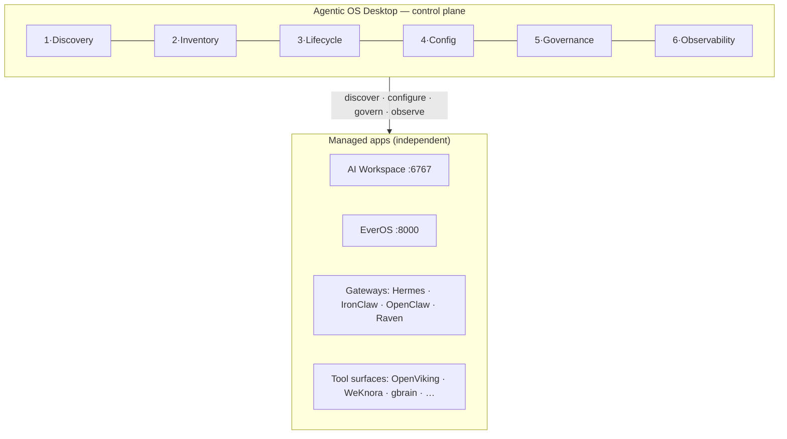

# Control-Plane Doctrine — Agentic OS as the operator's control plane over managed apps

> **Date:** 2026-10-08
> **Status:** DOCTRINE — supersedes `2026-10-07-second-brain-doctrine.md` (that doc inverted the relationship: it named the AI Workspace "the first brain" and made the console depend on it. The operator corrected this on 2026-10-08; the corrected model is below). Companion to `2026-10-08-desktop-overhaul-design.md` (the implementation spec).
> **Research basis:** 60+ references (Docker Desktop, Portainer, Lens, VS Code Remote, JetBrains Gateway, Open WebUI, Raven's 13-agent orchestration, Mem0/Zep/LangMem memory tiering, MCP host-governance specs, n8n/Dify/Temporal scheduling). Every mature system converges on the same six control-plane functions.

---

## 1. The model in one line

**The Agentic OS desktop is an independent control plane; the AI Workspace, EverOS, the runtime gateways, and the tool surfaces are managed apps it discovers, configures, governs, and observes — each keeping its own identity, memory scope, and lifecycle.**

- **The desktop works standalone.** Zero managed apps present, it is still a complete operating surface: its own runtime config, skills, memory surfaces, tools, MCP, schedules, governance. (Docker Desktop opens fine with no containers.)
- **Managed apps stay independent.** The workspace owns turns, sessions, files, voice, and its runner fabric. EverOS owns its Markdown memory. Gateways own their chat lanes. The desktop never absorbs them and never re-implements them.
- **Dependency arrow:** desktop → manages → apps. Never app → defines → desktop's onboarding or identity.

## 2. The six control-plane functions (the universal pattern)

Every case study implements the same six functions over a standard contract. The desktop's ManagedApp adapters (overhaul design §2) are these six functions, per app:

| Function | Desktop implementation |
|---|---|
| **Discovery** | Adapter `discover()` — scan/probe, found / not-found / auth-required |
| **Inventory** | Adapter `inventory()` — read-only mirrors rendered alongside desktop registries |
| **Lifecycle** | Adapter `lifecycle()` — mode-aware (local-spawn vs fabric-attach) |
| **Config** | Adapter `config()` — declared schema, isolated config block, operator-gated writes |
| **Governance** | Adapter `governance()` — approvals inbox, policies, audit hooks |
| **Observability** | Health + mirrors + bench sweep; never content copies |

## 3. Standing rules (locked)

1. **One transport.** The HTTP route registry is THE contract. There is no IPC/HTTP parity problem because there is no second transport. (Electron is retired; the browser is the only shell.)
2. **Capability-honest everywhere.** Adapters declare what they support; UI renders only declared capabilities; unseeded/degraded paths resolve to stable never-throw shapes. The degraded-shim crash class is banned at the architecture level.
3. **Config isolation.** Each managed app owns one config block. Cross-block writes are banned by CI. The workspace attach state never touches the gateway connection config (the B1 bug class).
4. **One write channel per app, operator-gated.** Workspace: bundle promotion, provision-env, approval verdicts. EverOS: none. Everything else read-only.
5. **Memory: scoped co-location, never fusion.** EverOS scopes partition apps (`app_id: "agentic-os"` vs `"ai-workspace"`); the desktop's own memory surfaces (gbrain, CMM, flat memory, wiki) remain distinct registries. The console renders and governs memory surfaces; it never merges them.
6. **Mode-aware lifecycle.** In fabric mode the console never spawns processes for managed services; start/stop map to compose services or read-only status.
7. **Shells are interchangeable; the contract is not.** Browser today; any future head (appliance, kiosk) is a thin view over the same registry.
8. **The bench never becomes a store; promotion stays operator-triggered** (carried unchanged from the prior doctrine).

## 4. What this doctrine corrects from the 2026-10-07 doc

| Was (wrong) | Now (correct) |
|---|---|
| Workspace = "first brain", console = "second brain" dependent on it | Desktop = independent control plane; workspace = managed app |
| First-run = "Looking for your AI Workspace…" ritual | First-run = registry discovery across all adapters; desktop onboards complete with zero apps found |
| Workspace attach written into gateway connection config | Workspace state in its own `desktop.json` block; CI-banned from connection config |
| Webview embed as a nav-level screen | Removed; external-browser affordance at most |
| EverOS = "third-party tool surface card" | EverOS = managed app with a desktop-provided dashboard (the UI its OSS lacks), v2 API |
| Two transports (IPC + HTTP) with a parity check | One transport (HTTP registry); parity check retired |

## 5. Verify steps for this doc

- Consistency with `2026-10-08-desktop-overhaul-design.md` §2 (contract rules) — checked on write.
- Consistency with the coordination matrix §4 (memory doctrine) — rule 5 above is the scoped-co-location refinement, not a contradiction.
- The six-function table must not contradict any adapter's declared capabilities once Phase B lands; re-check on each adapter addition.
